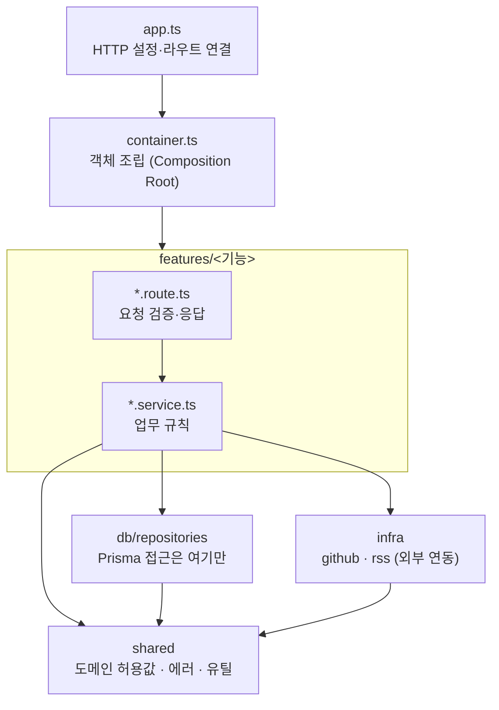

# 아키텍처

우아한테크코스 크루 검색 서비스(who.tech)의 백엔드와 어드민. GitHub 미션 레포의 PR과 크루 블로그 RSS를 모아 검색·피드 API로 내보낸다.

- 백엔드: Node 24 · Express · Prisma(SQLite) · Oracle Cloud 한 대(pm2)
- 어드민: `src/public/admin-spa` (React 19 · TanStack Query · Tailwind v4 · cva)
- 웹 프론트엔드는 [who-tech-frontend](https://github.com/iftype/who-tech-frontend) (같은 형식의 `apps/web/ARCHITECTURE.md`)

## 계층



| 폴더                 | 역할                                                          | 알면 안 되는 것         |
| -------------------- | ------------------------------------------------------------- | ----------------------- |
| `features/<기능>`    | route → service. 다른 기능은 `index.ts`(공개 진입점)로만 쓴다 | 다른 기능의 내부 파일   |
| `db/repositories`    | Prisma 쿼리. 서비스는 Prisma를 직접 부르지 않는다             | `features`              |
| `infra/github`·`rss` | GitHub API 클라이언트, RSS 수집·검사                          | `features`              |
| `shared`             | 허용값 목록(`domain.ts`), JSON 컬럼 파서, HTTP 에러, 미들웨어 | `features`·`db`·`infra` |
| `container.ts`       | 저장소 → 서비스 → 라우터 순으로 만들어 꽂는 유일한 곳         | —                       |

### 기능 사이의 순환을 끊는 포트

싱크 큐(`sync`)는 레포 수집과 블로그 수집을 실행하는데, 레포·블로그 기능도 싱크의 함수를 썼다(순환 2개). 큐가 필요한 것만 인터페이스로 선언하고(`features/sync/sync.ports.ts`의 `RepoSyncRunner`·`WorkspaceBlogSyncRunner`) 조립 코드가 구현을 꽂는다. → [ADR 0001](docs/adr/0001-feature-ports.md)

### 규칙은 CI가 지킨다

`npm run deps:check` (dependency-cruiser + `scripts/check-feature-cycles.mjs --strict`)

- 백엔드: 위 표의 방향, 기능 공개 진입점 외 참조 금지, 기능 간 순환 0
- 어드민: 순환 금지, 안 쓰는 모듈 금지, `lib`은 화면을 모름, `components/ui`는 다른 화면 코드에 기대지 않음, 탭 폴더끼리 참조 금지
- 어드민 색: 원시 팔레트(`text-gray-500`)를 쓰면 `npm --prefix src/public/admin-spa run lint:tokens` 실패

## 어드민 SPA

```
src/public/admin-spa/src/
  pages/<탭>Tab.tsx    탭 화면은 조립만 (지연 로딩, default export)
  pages/<탭>/          그 탭 전용 훅·컴포넌트 (member · sync · repo · archive)
  components/          공용 화면 조각 (Layout, StreamLogConsole …)
  components/ui/       기본 부품: Table·Tr·Th·Td, Button, Badge, TextInput·Select·Checkbox,
                       SectionTitle·Panel·EmptyState, TextLink, Modal, Toast (cva)
  hooks/               useEventStreamLog(SSE 진행 로그), useSortableData …
  lib/                 adminApi(엔드포인트 함수), queryKeys(쿼리 키 팩토리), 유틸
```

- 서버 호출은 `adminApi.*`, 캐시 키는 `queryKeys.*`만 쓴다 (화면에 경로 문자열·키 배열 0)
- 뮤테이션 토스트는 `lib/query-client.ts`의 `MutationCache`가 `meta.errorMessage`·`successMessage`로 한곳에서 띄운다 (토스트 함수는 `main.tsx`가 주입 — `lib`은 화면을 모른다)
- 인증 상태의 출처는 `AuthContext` 하나. `apiFetch`가 401을 받으면 `admin:unauthorized` 이벤트로 알리고 컨텍스트가 로그아웃한다
- 색은 역할별 계열(`base`·`primary`·`danger`·`success`·`accent` …, `index.css` `@theme`). 단계(500·600)는 그대로 두고 이름만 역할로 바꿔 화면이 1px도 바뀌지 않게 옮겼다 → [ADR 0004](docs/adr/0004-admin-role-colors.md)

## 새 기능을 추가하는 방법 (백엔드)

1. `features/<기능>/`에 `<기능>.route.ts`(입력 검증은 `<기능>.validation.ts`)와 `<기능>.service.ts`를 만든다
2. DB가 필요하면 `db/repositories/<대상>.repository.ts`에 쿼리를 둔다. 상태값은 `shared/domain.ts` 허용 목록에 추가한다
3. 외부 API는 `infra/`에 둔다. 다른 기능이 필요하면 그 기능의 `index.ts`에서 가져오고, 거꾸로 불러야 하면 포트를 만든다
4. `container.ts`에서 조립하고 `app.ts`에 라우트를 연결한다
5. 공개 응답이 바뀌면 `api-contract.int.test.ts` 스냅샷을 갱신하고 PR에 이유를 쓴다

## 바꿔도 안전한지 확인하는 장치

구조 개선은 "운영 기능 불변"이 원칙이었다. 이를 PR마다 기계로 확인했다. → [ADR 0003](docs/adr/0003-safety-nets.md)

| 장치             | 무엇을 고정하나                                                          | 위치                                                 |
| ---------------- | ------------------------------------------------------------------------ | ---------------------------------------------------- |
| API 계약 테스트  | 시드 데이터로 공개·어드민 API 응답 107개 스냅샷                          | `src/__tests__/integration/api-contract.int.test.ts` |
| 어드민 스크린샷  | 탭 9장 픽셀 비교 (Linux CI 기준 이미지)                                  | `e2e/admin`, `playwright.admin.config.ts`            |
| 동작 고정 테스트 | 탭을 나누기 전 흐름(편집·모달·SSE·폴링)을 쓰고 옛·새 코드 모두 통과 확인 | `*.flow.test.tsx`, `MemberTable.test.tsx`            |
| 운영 API 지문    | 배포 전후 27개 엔드포인트 응답 해시 비교                                 | `scripts/api-fingerprint.mjs`                        |
| DB 리허설        | 운영 DB 복사본에 마이그레이션·백필 → 지문·일관성 검사                    | `scripts/db-rehearsal/`, `src/db/consistency.ts`     |
| 뮤테이션 테스트  | 테스트가 실제로 버그를 잡는지 (주간)                                     | `stryker.config.mjs`                                 |

## DB를 멈추지 않고 바꾸는 법

확장 → 이전 → 축소를 별도 배포로 나누고, 운영 복사본으로 리허설한다. 이전 GitHub ID가 JSON 컬럼과 테이블에 이중 저장돼 2명이 옛 ID로 검색되지 않던 문제를 이 방식으로 고쳤다. → [ADR 0002](docs/adr/0002-expand-migrate-contract.md), 절차는 [`.claude/docs/db-changes.md`](.claude/docs/db-changes.md)

## 구조 개선 전후 (2026-10-19)

같은 측정 스크립트를 개선 전 커밋(`22f8af8`)과 후 커밋에 돌린 값.

| 항목                                   | 전                                  | 후                                                  |
| -------------------------------------- | ----------------------------------- | --------------------------------------------------- |
| 기능 간 순환 의존                      | 2 (repo↔sync, blog↔sync)            | 0 (CI 실패 처리)                                    |
| `app.ts` / `shared/validation.ts`      | 239줄 / 239줄 (전 기능 조립·검증)   | 154줄 / 42줄 (조립은 `container.ts`, 검증은 기능별) |
| 어드민 쿼리 키 문자열 직접 사용        | 69                                  | 0                                                   |
| 어드민 화면의 `apiFetch` 직접 호출     | 75                                  | 0                                                   |
| 어드민 원시 팔레트 색                  | 713                                 | 0 (CI 실패 처리)                                    |
| 어드민 같은 className 반복 (종류 / 곳) | 76 / 323                            | 36 / 126 (배치·글자 스타일만)                       |
| 어드민 가장 큰 컴포넌트                | 691줄 (MemberTable)                 | 212줄                                               |
| 어드민 공용 UI 부품                    | Modal·Toast                         | 19개 (cva, 클래스 집합 테스트)                      |
| 이전 GitHub ID 저장                    | JSON 컬럼과 테이블 이중, 2명 불일치 | 테이블 하나로 읽고 씀, 불일치 0                     |
| 상태값·JSON 컬럼 검증                  | 없음                                | 허용 목록·형식 검증 + 일관성 검사                   |

## 결정 기록

- [0001 기능 사이 순환은 포트로 끊는다](docs/adr/0001-feature-ports.md)
- [0002 DB는 확장 → 이전 → 축소로 바꾼다](docs/adr/0002-expand-migrate-contract.md)
- [0003 구조 변경의 안전망: 계약·스크린샷·운영 지문](docs/adr/0003-safety-nets.md)
- [0004 어드민 색은 역할별 계열로 옮긴다](docs/adr/0004-admin-role-colors.md)
- [0005 레포 싱크: PR 하나는 트랜잭션 하나, 통계는 다시 계산](docs/adr/0005-sync-unit-of-work.md)
- [0006 보안 수정과 에러 모델](docs/adr/0006-security-and-error-model.md)
